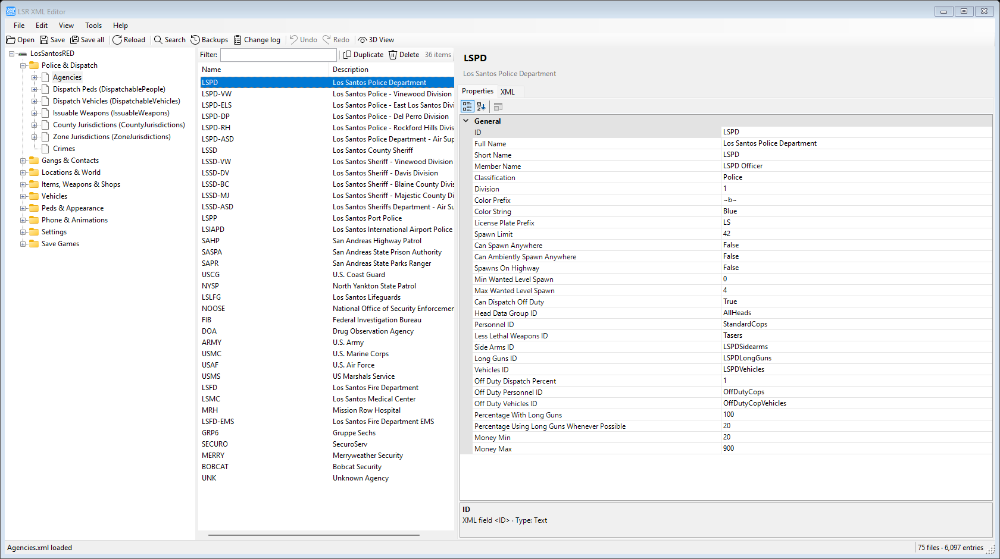
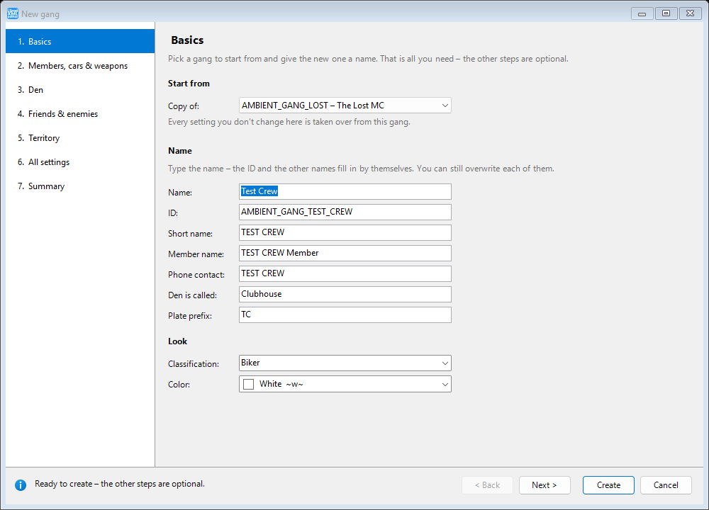
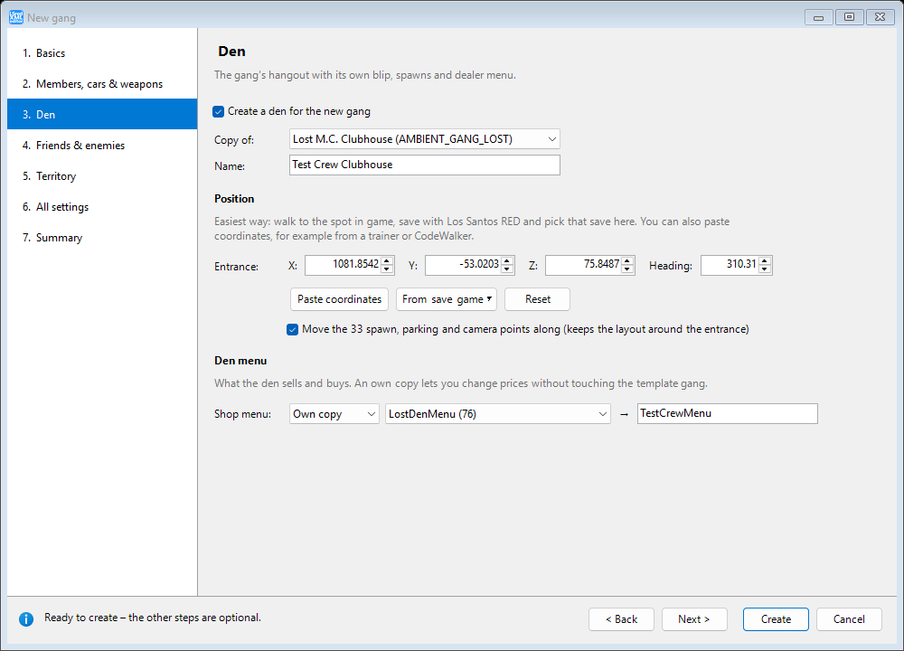
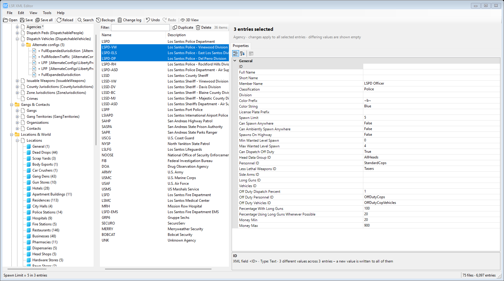
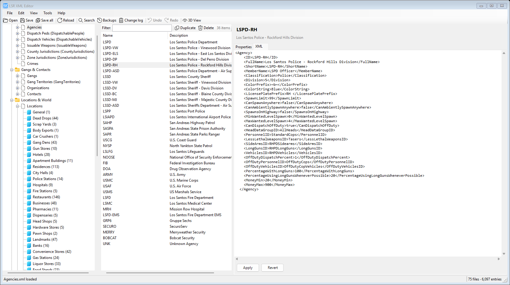
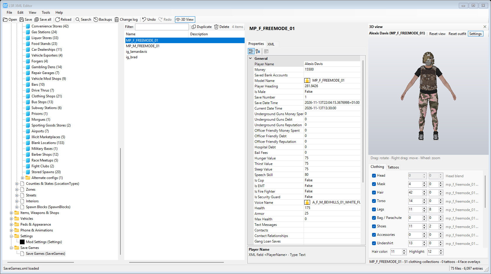
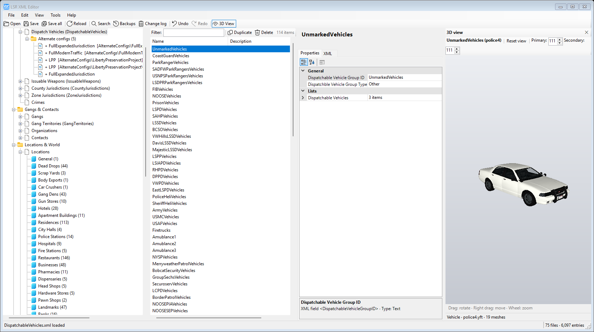
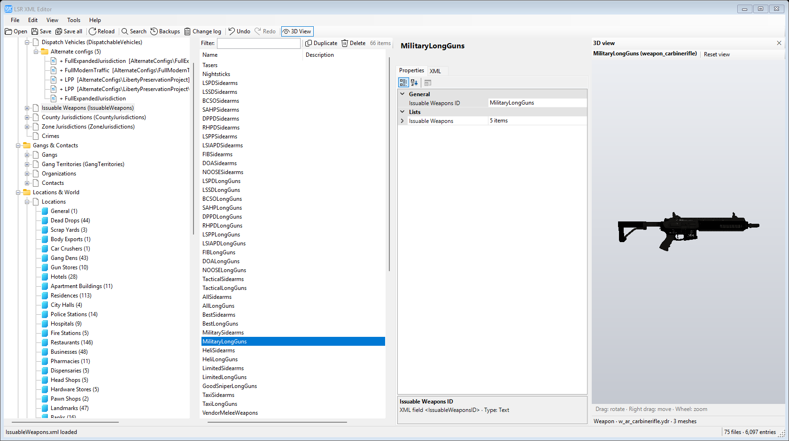
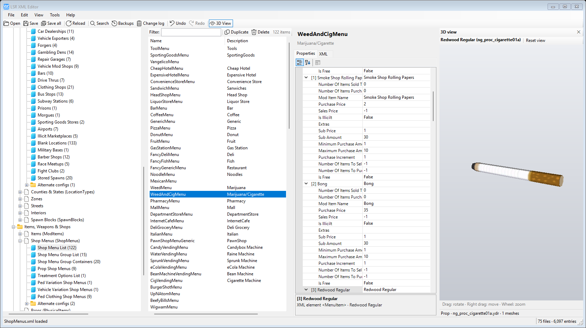
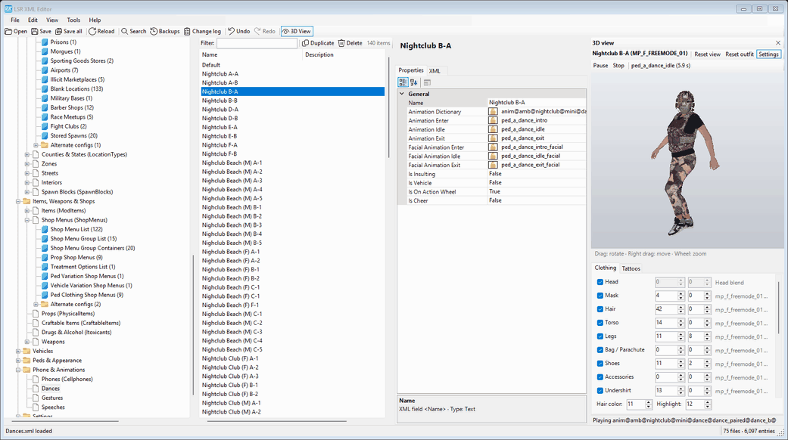

# LSR XML Editor

**Version 0.3 – beta**

A Windows editor for the XML configuration files of Los Santos RED (GTA V mod), with an optional 3D viewer for peds, vehicles, weapons, items and animations.
Runs completely offline – no auto-updater, no downloads, no telemetry.

> **Beta:** this is an early release. It has only been tested with the stock GTA V content and the default LSR configs, **not with custom content** such as add-on vehicles, weapons, peds or clothing. Please back up your configs before editing.
>
> **Tested with:** GTA V (Legacy, Steam) 1.0.3889.0 · Los Santos RED 1.0.0.562 · RAGE Plugin Hook 1.131.1424.17745
>
> Found a bug? Please report it as a [GitHub issue](../../issues) or on Discord to **onlyardo**.



## What's new

**Creators** for gangs, gang dens, shops/locations and police agencies (*Create* in the toolbar) – a step-by-step wizard:

- type a name, the ID and all other names fill in by themselves – the remaining steps are optional
- per linked group (peds, vehicles, weapons, heads, menus) choose an own copy or share any existing group
- every group shows who else uses it (hover "used by"), so you can see where a menu or ped group is in use
- menus step: see and change what the player can buy and sell (prices, stock, illicit), add or remove items – on an own copy, the original stays untouched
- shops and other places keep their owner (gang, agency, organization) or get a new one; spawns inside switch over too, and staff peds/weapons are linked like any other group
- place dens and shops from a Los Santos RED save game or pasted coordinates; spawn, parking and camera points move and turn along
- friends & enemies (optionally mutual), territory, jurisdiction and every other setting of the new entry
- live checks and a summary of what lands in which file – one Ctrl+Z undoes the whole thing

| | |
| --- | --- |
|  |  |

## Features

- All configs sorted by topic – Police & Dispatch, Gangs & Contacts, Locations & World, Items/Weapons/Shops, Vehicles, Peds, Phone & Animations, Settings, Save Games. Large files such as `Locations.xml` or `ModItems.xml` are split into their sections.
- Entry list with filter and sorting, properties in a standard Windows property grid with validated values, drop-downs and expandable lists, plus a raw XML view.
- Alternate configs (`File+_Name.xml` additive, `File_Name.xml` replacement) are detected and listed under their base file.
- Values that refer to GTA V itself (relationship groups, model names, animations, zone codes, voices) are locked with a padlock and can be unlocked on purpose.
- Edit several entries at once, duplicate or delete entries and list items.
- Undo and redo the last 10 changes (Ctrl+Z / Ctrl+Y).
- Creators for gangs, gang dens, shops/locations and police agencies based on existing entries.
- Search across all files and jump straight to the field (Ctrl+Shift+F).
- Automatic backup before every save, restore via *Tools → Backups*.
- Change log: every save is recorded as a diff and can be reapplied after an LSR update (*Tools → Change log*).
- Formatting is preserved: unchanged files are written back byte for byte.

### Screenshots

| | |
| --- | --- |
| <br>Editing several entries at once | <br>Raw XML of an entry |

## 3D viewer

Turn on **3D View** in the toolbar (or press Ctrl+3). Clicking an entry with a model or animation then opens the 3D view next to the property grid. It follows the selection in the list and in the property grid, so every model of a list – including the items of a shop menu – can be inspected. Turning the button off closes the view and frees its memory. Everything is read directly from your GTA V installation, nothing is modified there.

### Ped viewer

Outfits, save games and dispatchable peds with every clothing component (drawable/texture IDs as used by LSR), head blend, face overlays and hair colors.



### Vehicle viewer

Vehicles with wheels, glass, lights and paint (`RequiredPrimaryColorID` / `RequiredSecondaryColorID`, adjustable in the viewer).



### Weapon viewer

`weapon_*` names are resolved to their world model, including the weapon's default tint.



### Item viewer

Props and items from `PhysicalItems`, `ModItems` and interiors. Items of a shop menu are resolved through `ModItems.xml`, so clicking a menu item shows its model.



### Animations and gestures

Dances and gestures are played on the shown ped.



Hair, make-up and vehicle paint colors use approximate palettes.

## Download

Prebuilt packages are attached to the [releases](../../releases). Unzip and start `LsrXmlEditor.exe`. Requires the [.NET 10 Desktop Runtime](https://dotnet.microsoft.com/download/dotnet/10.0).

Trying it on a copy of the XML files first is recommended.

### Folders

The editor needs up to three folders and asks for each one it cannot find on its own. Every choice is remembered.

| Folder | Found automatically | Otherwise |
| --- | --- | --- |
| Los Santos RED XML files | last used folder, `...\Grand Theft Auto V\Plugins\LosSantosRED` of every GTA V installation registered in Windows (Steam, Epic, Rockstar) | asks for the folder; the GTA V or `Plugins` folder can be selected as well |
| GTA V (3D view only) | two levels above the XML folder, registered installations | asks for the folder that contains `GTA5.exe` |
| CodeWalker (3D view only) | last used folder | asks for the CodeWalker folder the first time **3D View** is turned on |

### CodeWalker

The 3D view reads the game archives with [CodeWalker](https://github.com/dexyfex/CodeWalker), which is **not included** in this project. Download CodeWalker (or build `CodeWalker.Core` from its source) and select its folder when asked; the editor looks for `CodeWalker.Core.dll` in that folder and its subfolders. If a CodeWalker version turns out to be incompatible, the editor says so and asks again next time. Everything else works without CodeWalker.

## Dependencies

| Package | Used for | License |
| --- | --- | --- |
| [.NET 10](https://dotnet.microsoft.com/) (Windows Forms, WPF) | application framework, 3D rendering | MIT |
| [CodeWalker.Core](https://github.com/dexyfex/CodeWalker) | reading the GTA V archives (3D view only), provided by the user | see the CodeWalker repository; not redistributed |
| [SharpDX 4.2.0](https://www.nuget.org/packages/SharpDX) | math types required by CodeWalker.Core (3D view only) | MIT |
| [SharpDX.Mathematics 4.2.0](https://www.nuget.org/packages/SharpDX.Mathematics) | vectors and matrices (3D view only) | MIT |

The editor itself has no third-party dependencies. The 3D viewer is a separate plugin; without it the editor works the same, only the 3D view is unavailable.

## Build

Requires Windows 10/11 and the [.NET 10 SDK](https://dotnet.microsoft.com/download/dotnet/10.0).

```bash
dotnet build -c Release
dotnet run --project src/LsrXmlEditor -c Release
```

A folder can be passed directly:

```bash
dotnet run --project src/LsrXmlEditor -c Release -- "D:\Copy\LosSantosRED"
```

The 3D viewer plugin needs CodeWalker.Core, which is not part of this repository:

```bash
git clone https://github.com/dexyfex/CodeWalker.git %USERPROFILE%\Documents\CodeWalker
dotnet build %USERPROFILE%\Documents\CodeWalker\CodeWalker.Core -c Release
dotnet build src/LsrXmlEditor.PedViewer -c Release
```

The plugin builds into `src/LsrXmlEditor/bin/<Configuration>/net10.0-windows/PedViewer/` and is picked up automatically. Pass `-p:CodeWalkerCorePath=...` if CodeWalker lives elsewhere. Local builds copy `CodeWalker.Core.dll` next to the plugin; release packages leave it out.

## Data

| What | Where |
| --- | --- |
| Settings | `%LOCALAPPDATA%\LsrXmlEditor\settings.json` |
| Backups | `%LOCALAPPDATA%\LsrXmlEditor\Backups\<folder>\<timestamp>\` |
| Change log | `%LOCALAPPDATA%\LsrXmlEditor\Changes\<folder>.json` |

## Project structure

```
src/LsrXmlEditor.Core           XML model, structure detection, scanner, backups, diff/replay, search
src/LsrXmlEditor                Windows Forms UI
src/LsrXmlEditor.PedViewer      optional 3D viewer plugin (WPF, CodeWalker.Core)
tests/LsrXmlEditor.Tests        round-trip, diff, replay and search tests against real LSR files
tests/LsrXmlEditor.UiSnapshots  drives edit/save through the UI and renders screenshots
```

Run the tests against a folder of LSR XML files (preferably a copy):

```bash
dotnet run --project tests/LsrXmlEditor.Tests -c Release -- "D:\Copy\LosSantosRED"
```

## License

MIT
